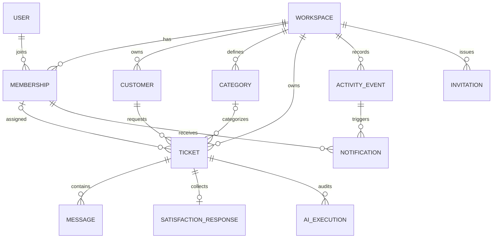

# Architecture and implementation plan

## Boundaries

SupportFlow serves teams in isolated workspaces. Admins manage the team and workspace; agents handle tickets and customers. Customers use limited public survey links.

| Module | Responsibility |
| --- | --- |
| `desk/models.py` and migrations | SQL relationships, constraints and indexes |
| `desk/services.py` | Transactional business operations |
| `desk/forms.py` | Validation and scoped relationship choices |
| `desk/views.py` | HTML workflows and authentication |
| `desk/api.py` | Versioned JSON API and errors |
| `desk/analytics.py` | Metrics over persisted records |
| `desk/ai.py` | Providers, bounded inputs and validated outputs |
| `templates/` and `static/desk/` | Responsive UI and progressive enhancement |

Django sessions authenticate users. Active membership selects a workspace. Queries filter by workspace before selecting a record by ID. Admin actions require server-side role checks. Transactions keep ticket changes, events and notifications consistent. Revisions prevent stale edits. PostgreSQL row locks serialize numbering and updates. Deleted tickets are soft-deleted.

## Schema

- Workspace: name, timezone, next ticket number.
- Membership: user, workspace, role, active state.
- Customer: name, email, phone, company, notes. Email is unique per workspace.
- Ticket: customer, subject, request, status, priority, category, assignee, revision and lifecycle timestamps.
- Message: body, author/customer, kind, internal visibility.
- ActivityEvent: actor, change description and structured changes.
- Notification: recipient, event, read timestamp.
- SatisfactionResponse: ticket, token digest, score, comment, submission time.
- Invitation: workspace, token digest, email, role, expiry, acceptance time.
- AIExecution: ticket, provider, model, operation, source revision, outcome, latency.

## Tasks and assignments

One branch and one writer integrate changes. Read-only checks can run in parallel.

| Task | Owner | Dependency | Parallel review |
| --- | --- | --- | --- |
| Schema, auth, seed | Primary developer | None | Schema/isolation |
| Support workflows | Primary developer | Models and roles | Permissions/lifecycle |
| Layout and pages | Primary developer | Forms and routes | Mobile/accessibility |
| Analytics | Primary developer | Timestamp definitions | Metric reconciliation |
| AI adapters | Primary developer | Snapshot/revision contract | Privacy/errors |
| Activity/notifications | Primary developer | Transactional events | Recipient isolation |
| Delivery | Primary developer | All workflows | Read-only reviewer |

## Integration risks

Workspace isolation must cover URLs, APIs and foreign-key values. Creation and resolution windows need separate queries. Response time measures the first public agent response; internal notes do not count. Satisfaction measures submitted scores of 4 or 5.

Stale writes must conflict. AI suggestions need human review. SQLite supports a local demo; concurrent production writes need PostgreSQL. Multiple workers need a shared cache for rate limits. Invitations and password resets need SMTP. Ticket replies remain inside the workspace; they do not imply email delivery. Demo AI is a simulation. Remote credentials, TLS, monitoring and backups belong to the deployment environment.
